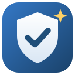
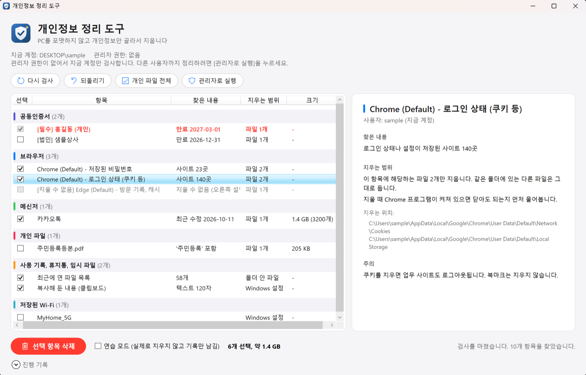
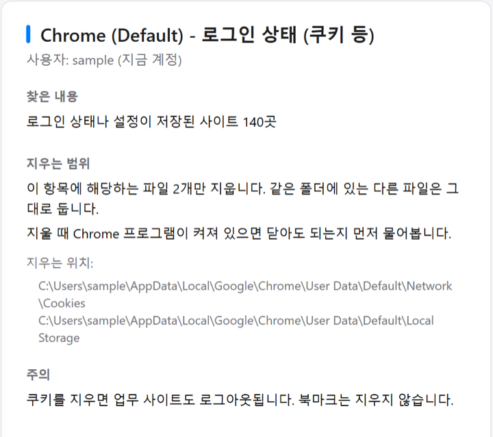

# 개인정보 정리 도구

회사 PC를 포맷하지 않고 개인정보만 골라서 지웁니다.

업무 프로그램과 업무 파일은 그대로 두고, 개인정보가 남은 곳만 찾아서 보여 줍니다. 지우는 것은 체크한 항목뿐입니다.

## 사용 방법

1. zip을 받아 압축을 풉니다.
2. `PcPrivacyCleaner.exe`를 실행합니다. 검사가 바로 시작됩니다.
3. '연습 모드'로 한 번 실행해서 무엇이 지워지는지 확인합니다.
4. 연습 모드를 끄고 [선택 항목 삭제]를 누릅니다.

> [!WARNING]
> 지운 파일은 휴지통에 남지 않아서 되돌릴 수 없습니다.

## 정리하는 항목

| 분류 | 내용 | 처음 상태 |
|---|---|---|
|  | 개인, 업무용, 법인 인증서와 Windows에 저장된 인증서 | 개인 인증서는 필수 |
|  | Chrome, Edge, 웨일, Brave, Firefox의 비밀번호, 쿠키, 방문 기록 | 켜짐 |
|  | 카카오톡, 텔레그램, 라인, 디스코드 로그인 | 켜짐 |
|  | 이름으로 찾은 개인 파일, 카카오톡 받은 파일 | 개인 파일은 꺼짐 |
|  | 최근 파일, 검색 기록, 휴지통, 임시 파일, 클립보드 | 켜짐 |
|  | Windows에 저장된 로그인 정보, Wi-Fi | 꺼짐 |

업무용과 섞일 수 있는 항목은 처음에 꺼져 있습니다.

## 지우기 전에 미리 보여 줍니다

항목을 고르면 오른쪽에 찾은 내용, 지울 파일 경로, 주의할 점이 나옵니다.

비밀번호나 쿠키 값은 읽지 않습니다. 찾은 내용은 화면에만 보여 주고 기록 파일에 남기지 않습니다.

 

## 자주 묻는 질문

'Windows의 PC 보호' 창이 나와요

[추가 정보]를 누른 뒤 [실행]을 누르세요. 코드 서명이 없어서 나오는 경고입니다.

회사 보안 프로그램이 막아요

브라우저 파일을 읽는 동작 때문에 막힐 수 있습니다. IT 담당자에게 먼저 물어보세요.

관리자 권한이 필요한가요?

필요하지 않습니다. [관리자로 실행]을 누르면 다른 사용자 계정까지 검사합니다.

## 요구 사항

Windows 10(1607 이상)과 Windows 11에서 실행됩니다.
